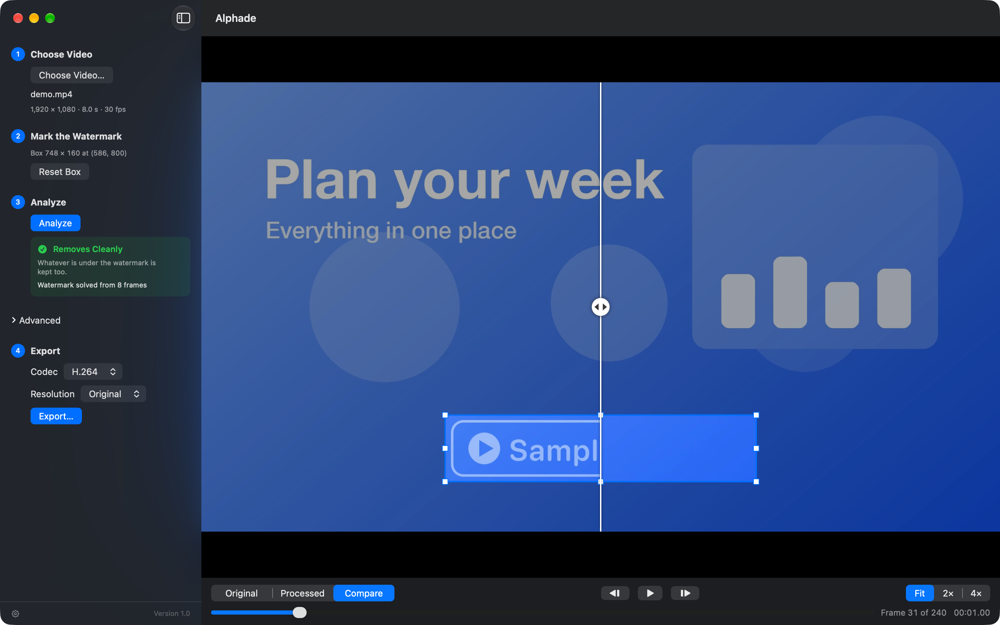

# Alphade

Entferne halbtransparente Wasserzeichen, Logos und Texteinblendungen aus deinen eigenen Videos, direkt auf deinem Mac. Alphade holt das Bild darunter zurück, statt die Stelle zu verwischen.

[English](README.md) | Deutsch | [Español](README-es.md) | [Français](README-fr.md) | [日本語](README-ja.md) | [한국어](README-ko.md) | [繁體中文](README-zh_TW.md)



## Was es kann

Zieh einen Rahmen um die Einblendung. Alphade untersucht das ganze Video, ermittelt, wie die Einblendung hineingemischt wurde, und rechnet sie in jedem Bild wieder heraus. Ist ein Logo deckend und liegt auf einem schlichten Hintergrund, füllt Alphade die Stelle stattdessen weich aus der Umgebung auf.

- **Wiederherstellen statt verwischen**: Ein halbtransparentes Wasserzeichen wird aus dem Bild herausgerechnet, sodass wieder zu sehen ist, was darunter lag.
- **Vorher wissen, was herauskommt**: Nach der Analyse zeigt Alphade eines von drei Ergebnissen an: „Sauber entfernbar“, „Entfernbar durch Auffüllen“ oder „Nach dem Entfernen unscharf“.
- **Jedes Bild prüfen**: Geh Bild für Bild durch das Ergebnis, vergleiche es direkt mit dem Original und spiel es ab jeder Stelle ab.
- **Nur der Rahmen ändert sich**: Exportiere in Originalgröße oder verkleinert auf 1080p oder 720p, als H.264 oder HEVC. Der Ton wird unverändert übernommen.
- **Privat**: Alles läuft auf deinem Mac. Videos werden nie hochgeladen, du brauchst kein Konto, Alphade baut keine Netzwerkverbindungen auf und sammelt keine Daten.
- **Kostenlos**.

## Installation

Erfordert macOS 26 oder neuer. Getestet auf Macs mit Apple Chips. Alphade ist mit einer Developer ID signiert und von Apple notariell beglaubigt.

### Download

1. Lade [`Alphade.zip`](../../releases/latest/download/Alphade.zip) aus dem [neuesten Release](../../releases/latest) herunter.
2. Öffne die ZIP-Datei und zieh **Alphade** in den Ordner „Programme“.
3. Öffne Alphade. macOS fragt, ob du eine aus dem Internet geladene App öffnen möchtest; klicke auf **Öffnen**.

Zum Deinstallieren zieh Alphade in den Papierkorb. Einstellungen und temporäre Dateien liegen in `~/Library/Containers/app.vulcanshen.alphade`; diesen Ordner kannst du ebenfalls löschen.

### Homebrew

```sh
brew install --cask vulcanshen/tap/alphade
```

Aktualisieren mit `brew upgrade --cask alphade`. Deinstallieren mit `brew uninstall --cask alphade`; mit `--zap` werden auch Einstellungen und temporäre Dateien gelöscht.

## Schnellstart

1. Klicke auf **Video auswählen …** (oder zieh ein Video ins Fenster).
2. Zieh einen Rahmen um das Wasserzeichen, mit etwas Abstand auf allen Seiten.
3. Klicke auf **Analysieren**.
4. Prüfe das Ergebnis mit **Original**, **Bearbeitet** und **Vergleichen**.
5. Klicke auf **Exportieren …** und wähle den Speicherort. Als Name ist `<Originalname>_nowm.mp4` vorausgefüllt.

Die Oberfläche folgt der Systemsprache: English, Deutsch, Español, Français, 日本語, 한국어 oder 繁體中文. Du kannst sie in den Einstellungen wechseln.

## Tastatur

| Tasten | Aktion |
|---|---|
| ⌘O | Video öffnen |
| ⌘E | Exportieren |
| ⌘1 / ⌘2 / ⌘3 | Original / Bearbeitet / Vergleichen |
| ← / → | Vorheriges / nächstes Bild |
| Leertaste | Wiedergabe oder Pause (stumm) |
| O gedrückt halten | Zeigt das Original, solange die Taste gedrückt ist |
| ⌘+ / ⌘− | Vergrößern / verkleinern (nachdem der Rahmen gezogen ist) |
| ⌘, | Einstellungen (Sprache) |

## Funktioniert am besten mit

- Halbtransparenten Wasserzeichen, Logos und Texten, die das ganze Video über an derselben Stelle bleiben
- Deckenden Logos auf schlichten Hintergründen wie Volltonfarben, Verläufen und Präsentationsfolien
- MP4-, MOV- und M4V-Videos mit 8 Bit (SDR)

## Nicht unterstützt

- Wasserzeichen, die sich bewegen oder ihre Position ändern
- Deckende Wasserzeichen auf detailreichen Hintergründen oder Realaufnahmen (die Stelle wird unscharf)
- Videos mit 10 Bit und HDR

## Nur für deine eigenen Videos

Bearbeite nur Videos, die dir gehören oder die du ändern darfst. Das Entfernen fremder Wasserzeichen kann gegen das Urheberrecht deines Landes verstoßen, und du bist dafür verantwortlich, wie du Alphade verwendest.

## Feedback

Probleme und Ideen kannst du unter [Issues](../../issues) melden. Der Quellcode ist nicht öffentlich.

## Mitwirkende

<a href="https://github.com/vulcanshen"></a>
<a href="https://github.com/claude"></a>

Entwickelt von [Vulcan Shen](https://github.com/vulcanshen) und [Claude](https://github.com/claude) mit Claude Code.

## Lizenz

Alphade kann kostenlos heruntergeladen und verwendet werden. © 2026 Vulcan Shen. Alle Rechte vorbehalten. Alphade wird „wie besehen“ und ohne jegliche Gewährleistung bereitgestellt.
