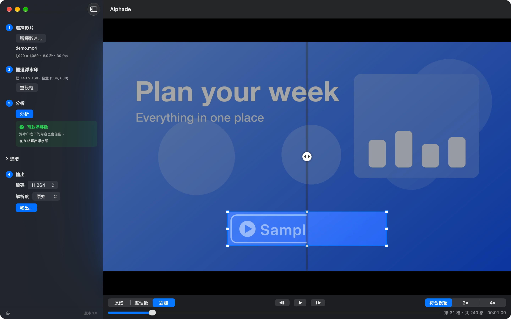

# Alphade

在你的 Mac 上，去除你自己影片上的半透明浮水印、logo 與文字疊圖。Alphade 會把底下原本的畫面還原回來，不是把它糊掉。

[English](README.md) | 繁體中文



## 它能做什麼

在浮水印周圍拉一個框，Alphade 會分析整支影片，算出浮水印是怎麼疊上去的，再逐格反推回原本的畫面。如果浮水印是不透明的、背景又很單純，就改用周圍的背景平滑填補。

- **還原，不是糊掉**：半透明浮水印會從畫面中扣掉，底下原本的內容會重新出現。
- **輸出前就告訴你結果**：分析完會說明這個浮水印「可乾淨移除」、「可移除（用背景補上）」還是「移除後會模糊」。
- **每一格都能檢查**：逐格檢視、和原始畫面左右對照，也能從任一格開始播放。
- **只改框起來的地方**：輸出可保留原始解析度，或縮小到 1080p、720p，格式可選 H.264 或 HEVC，音訊原樣保留。
- **完全在你的 Mac 上處理**：影片不會上傳，不需要帳號，Alphade 不連網路，也不收集任何資料。
- **免費**。

## 安裝

需要 macOS 26 以上。已在 Apple 晶片的 Mac 上測試。Alphade 已用 Developer ID 簽章，並經過 Apple 公證。

### 直接下載

1. 從 [Releases](../../releases/latest) 下載 `Alphade-<版本>.zip`。
2. 打開 zip，把 **Alphade** 拖進「應用程式」資料夾。
3. 打開 Alphade。macOS 會問是否要打開從網路下載的 app，按「打開」。

移除時把 Alphade 拖到垃圾桶即可。它的設定與暫存檔在 `~/Library/Containers/app.vulcanshen.alphade`，也可以一併刪除。

### Homebrew

```sh
brew install --cask vulcanshen/tap/alphade
```

更新用 `brew upgrade --cask alphade`。移除用 `brew uninstall --cask alphade`；加上 `--zap` 會連設定與暫存檔一起刪除。

## 快速開始

1. 按 **選擇影片…**，或直接把影片拖進視窗。
2. 在浮水印周圍拉一個框，四邊各留一點空間。
3. 按 **分析**。
4. 用 **原始**、**處理後**、**對照** 檢查結果。
5. 按 **輸出…**，選擇存放位置。檔名會預填為 `<原檔名>_nowm.mp4`。

介面會依系統語言顯示繁體中文或英文，也可以在設定裡切換。

## 快捷鍵

| 按鍵 | 功能 |
|---|---|
| ⌘O | 開啟影片 |
| ⌘E | 輸出 |
| ⌘1 / ⌘2 / ⌘3 | 原始／處理後／對照 |
| ← / → | 上一格／下一格 |
| 空白鍵 | 播放或暫停（靜音） |
| 按住 O | 按住時顯示原始畫面 |
| ⌘+ / ⌘− | 放大／縮小（拉好框之後） |
| ⌘, | 設定（語言） |

## 最適合

- 位置固定、整支影片都在同一處的半透明浮水印、logo 與文字
- 疊在單純背景（純色、漸層、簡報畫面）上的不透明 logo
- 8-bit（SDR）的 MP4、MOV、M4V 影片

## 不支援

- 會移動或改變位置的浮水印
- 疊在細節豐富或實拍畫面上的不透明浮水印（那一塊會變模糊）
- 10-bit 與 HDR 影片

## 請只用在你自己的影片

請只處理你擁有或已取得授權修改的影片。移除別人的浮水印，在你所在的地區可能違反著作權法；如何使用 Alphade 由你自行負責。

## 意見回饋

問題與建議請到 [Issues](../../issues) 回報。原始碼不公開。

## 授權

Alphade 可免費下載與使用。© 2026 Vulcan Shen，保留所有權利。Alphade 依「現狀」提供，不附任何形式的保證。
